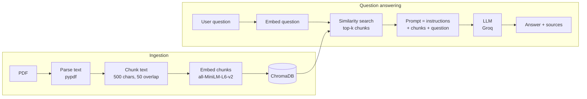

# Chat with Your PDF (RAG)

Ask questions about a text-based PDF and get answers grounded in the document, with the source passages shown for every answer.

This project is a complete Retrieval-Augmented Generation (RAG) pipeline: PDF parsing, chunking, embeddings, a vector store, retrieval, and LLM answer generation, wrapped in a Streamlit web app.

**Live demo:** [https://chat-with-pdf-rag-kmfpbmjxypscjchuvqcwkq.streamlit.app/]

---

## Why this project

Large language models answer from what they learned in training, so they can guess or invent details when they don't know something (hallucination). RAG reduces this by retrieving the relevant text from your own document first and giving it to the model as context.

This app is built so that:
- Answers come from the uploaded PDF, not from the model's general knowledge.
- Every answer shows the exact chunks it was based on, so you can verify it.
- If the answer is not in the document, the app says so instead of guessing.

---

## Features

- **PDF upload:** upload any text-based PDF in the browser.
- **Grounded answers:** the model is instructed to answer only from the retrieved context.
- **Source citations:** each answer includes an expandable "Sources" section with the retrieved chunks.
- **"I don't know" handling:** if the document doesn't contain the answer, the app replies that it doesn't have enough information.
- **Configurable retrieval:** a sidebar slider sets how many chunks (k = 1 to 10) are retrieved per question.
- **Chat history:** previous questions, answers and sources stay visible during the session.

---

## How it works



**Ingestion (runs when a PDF is uploaded)**
1. Text is extracted from each page with `pypdf`.
2. The text is split into chunks of 500 characters with 50 characters of overlap using LangChain's `RecursiveCharacterTextSplitter`.
3. Each chunk is converted into an embedding vector with the `all-MiniLM-L6-v2` sentence-transformer model.
4. The vectors and their text are stored in a ChromaDB vector store.

**Question answering (runs for every question)**
1. The question is embedded with the same model.
2. ChromaDB returns the top-k most similar chunks.
3. The chunks are labelled `[Source 1]`, `[Source 2]`, and so on, and combined with the question and a system prompt.
4. The LLM (served by Groq) writes an answer using only that context.
5. The app displays the answer along with the retrieved source chunks.

---

## Tech stack and why

| Tool | Purpose | Why this choice |
|---|---|---|
| Python | Language | Standard for ML and data work |
| Streamlit | Web UI | Quick to build and easy to deploy |
| LangChain | Pipeline components | Ready-made splitter, vector store and LLM integrations |
| pypdf | PDF text extraction | Simple and lightweight |
| sentence-transformers (`all-MiniLM-L6-v2`) | Embeddings | Small (about 90 MB), free, runs locally |
| ChromaDB | Vector store | Easy setup with no separate server |
| Groq (`openai/gpt-oss-20b`) | LLM | Fast inference and a free tier |
| python-dotenv | Configuration | Keeps the API key out of the code |

---

## Project structure

```
chat-with-pdf-rag/
├── app.py              # Streamlit UI (upload, chat, sources, k slider)
├── ingestion.py        # PDF loading, chunking, embeddings, vector store
├── generation.py       # Prompt construction and LLM call
├── test_retrieval.py   # Checks retrieval on its own, before involving the LLM
├── requirements.txt    # Python dependencies
├── .env.example        # Template for the API key (copy to .env)
├── .gitignore          # Keeps .env and venv out of Git
└── README.md
```

---

## Run it locally

**Requirements:** Python 3.9 or newer and a free [Groq API key](https://console.groq.com) (no credit card needed).

**1. Clone the repository**
```bash
git clone https://github.com/Ankitkash/chat-with-pdf-rag.git
cd chat-with-pdf-rag
```

**2. Create and activate a virtual environment**

Windows:
```bash
python -m venv venv
venv\Scripts\activate
```

**3. Install dependencies**
```bash
pip install -r requirements.txt
```
The first run also downloads the embedding model (about 90 MB).

**4. Add your API key**

Create a file named `.env` in the project folder:
```
GROQ_API_KEY=your_key_here
```
The `.env` file is listed in `.gitignore`, so your key is never committed.

**5. Start the app**
```bash
streamlit run app.py
```
Open the link shown in the terminal, upload a PDF and start asking questions.

---

## Example usage

1. Upload a text-based PDF, such as a report, notes or a policy document.
2. Ask a specific question, for example: *"What is the notice period mentioned in the document?"*
3. Read the answer and open **Sources** to see the chunks it was based on.
4. Ask something that is not in the document. The app should reply that it doesn't have enough information.

---

## Design decisions

- **Retrieval is tested separately.** `test_retrieval.py` prints the retrieved chunks for a question before the LLM is involved. If the chunks are wrong, the final answer will be wrong too, so retrieval is validated first.
- **Low temperature (0.1).** Keeps answers focused and consistent with the retrieved text.
- **Strict system prompt.** The model is told to use only the supplied context, to cite the relevant source, and to say when the answer is missing.
- **Chunk overlap.** A 50-character overlap helps keep sentences that fall on a chunk boundary from losing their context.

---

## Limitations

- **Text-based PDFs only.** Scanned PDFs or photographed pages contain no extractable text, and this project does not include OCR.
- **One PDF at a time.** Uploading a new file replaces the previous one.
- **Tables and images.** Table text may be extracted in a messy order, and images are ignored.
- **Best for specific questions.** Only the top-k chunks are read, so broad requests such as "summarize the whole document" can give incomplete answers.
- **Session-only storage.** The vector store lives in memory and is rebuilt when the app restarts or a new file is uploaded.
- **Hallucinations are reduced, not eliminated.** The model can still misread the retrieved text, so check important answers against the source chunks.

---

## Future improvements

- Hybrid search (keyword plus vector) for better retrieval
- Re-ranking retrieved chunks before sending them to the LLM
- Larger or domain-specific embedding models
- OCR support for scanned PDFs
- Multiple PDFs in one knowledge base, with persistent storage
- Better handling of tables and layout
- Evaluation of retrieval and answer quality on a set of test questions

---

## Author

**Ankit Kashyap**
[GitHub](https://github.com/Ankitkash) | [LinkedIn](<https://www.linkedin.com/in/ankitkash/>)
